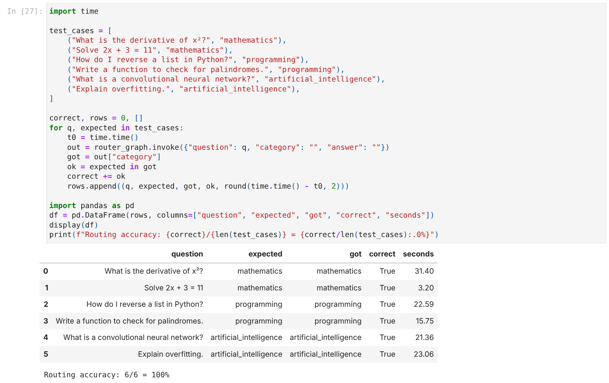
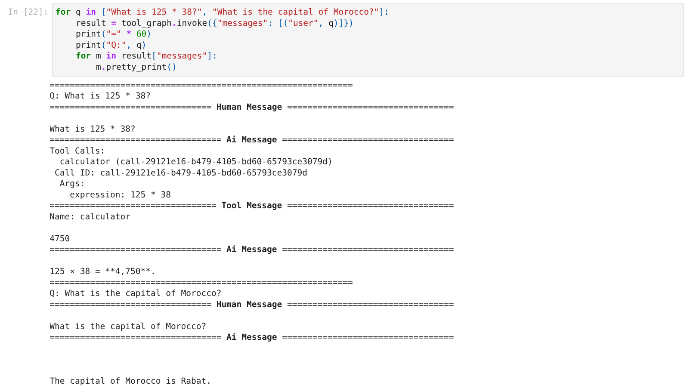
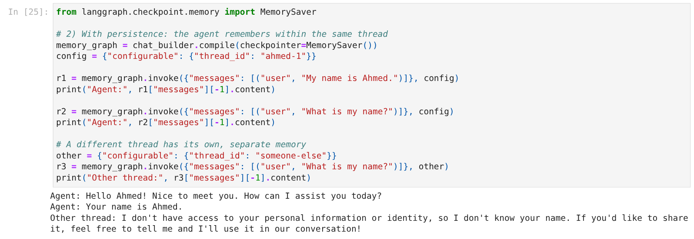
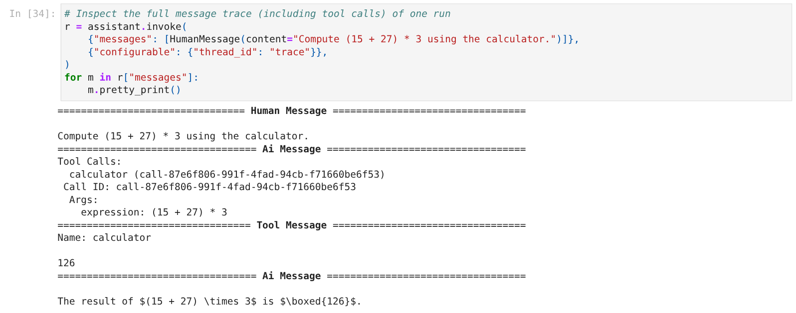

# Building AI Agents with LangGraph — Practical Lab

This lab builds agents with **LangGraph**, step by step:
- a first state graph;
- an LLM node and a two-stage analyzer → answer pipeline;
- conditional routing;
- tool calling (a safe calculator and the date/time);
- conversational memory;
- a minimal evaluation harness;
- the capstone, an **Intelligent University Assistant** that combines all of the above.

📓 **Notebook with all outputs and answers:** [`langgraph_lab.ipynb`](langgraph_lab.ipynb) · 📄 **Report:** [`report/report.pdf`](report/report.pdf)

## LLM used: a free model on OpenRouter

The statement uses the OpenAI API. Instead, this lab uses a **free model on [OpenRouter](https://openrouter.ai)**: no OpenAI key, no cost. OpenRouter exposes an OpenAI-compatible API, so `ChatOpenAI` works unchanged once it points at OpenRouter's URL. This is the only code change made to the statement (cell *Exercise 3*):

```python
llm = ChatOpenAI(
    model="google/gemma-4-31b-it:free",
    base_url="https://openrouter.ai/api/v1",
    api_key=os.environ["OPENAI_API_KEY"],      # holds the OpenRouter key (sk-or-...)
    temperature=0,
    max_retries=5,
    extra_body={"models": [                     # fallbacks if a provider is rate-limited
        "google/gemma-4-31b-it:free",
        "poolside/laguna-s-2.1:free",
        "openrouter/free",
    ]},
)
```

- **Primary model:** `google/gemma-4-31b-it:free`. It supports tool calling, which Parts VIII and X need.
- **Fallback list:** if the primary model's provider returns `429 Provider returned error` (free capacity is shared by all users), OpenRouter answers with the next model in the list instead of failing.
- **Free-tier limits:** 20 requests/min and **50 requests/day**, reset at 00:00 UTC. One full run of the notebook uses roughly 50 model calls. If you hit the limit, continue the next day by re-running only the definition cells and then the remaining cells.
- **No key in the code:** the key is read from the environment.

## Setup (Windows)

```powershell
git clone <this repository> ; cd <repository>

# OpenRouter key (create one at https://openrouter.ai/keys)
$env:OPENAI_API_KEY = "sk-or-..."      # used by the notebook
```

Tested with Python 3.14.6, LangGraph 1.2.18 and LangChain 1.4.7.

## How to run

**Notebook:** open `langgraph_lab_Statement.ipynb` in Jupyter or VS Code and run the cells top to bottom.

### Design choices

- **Free model through OpenRouter, with fallbacks:** no cost and no OpenAI account. The price is rate limits and the possibility that a fallback model answers instead of Gemma.
- **Safe calculator:** the statement's `eval()` version is kept only for comparison. The agents use an `ast`-based evaluator that accepts only numbers and arithmetic operators, so `__import__('os')` returns `Invalid expression`.
- **One tool node shared by all agents:** `route_after_tools` reads `category` from the state to return to the agent that asked, so each specialist writes its own final answer.
- **Errors become messages, not crashes:** the user always gets an answer, and the cause is visible in the category (`EMPTY` or `ERROR`).

## Results (from the executed notebook)

| Test | Result |
|---|---|
| First graph (Ex. 2) | `{'message': 'Hello LangGraph!', 'response': 'Agent received: Hello LangGraph!'}`, as expected |
| Router (Ex. 6–7) | 3/3 questions routed correctly |
| Tool agent (Part VIII) | `125 * 38` → calculator call → 4,750; "capital of Morocco" → no tool → Rabat |
| Memory (Ex. 9) | without a checkpointer the name is forgotten; with `MemorySaver` → "Your name is Ahmed."; another thread → unknown |
| Routing evaluation | **6/6 = 100 %**, 3.2–31.4 s per question (mean 19.6 s, free tier) |
| Capstone | 6 demo queries routed to the expected category; date question → "Friday, 30 October 2026" (date-tool value); empty input → fallback; memory test passed; trace: calculator → 126 |

## Repository structure

```text
├── langgraph_lab_Statement.ipynb          # the lab: code, outputs, answers to the questions
├── report/report.pdf                      # short report (conceptual answers, results, discussion)
├── docs/                                  # architecture diagram (PNG + Mermaid), compiled graphs
├── screenshots/                           # execution screenshots (01 … 10)
└── .env.example
```

## Screenshots

| Routing evaluation | Tool-using agent |
|---|---|
|  |  |

| Memory | Capstone tool trace |
|---|---|
|  |  |

All screenshots are in [`screenshots/`](screenshots/), including the full capstone demo (`07_capstone_demo.png`).
